# Training-Data Analysis Report — Aura Calibration-Free EMG Challenge

**Companion to** [`Aura_EMG_Competition_Guide.md`](Aura_EMG_Competition_Guide.md)
**Dataset version:** 2 (29 Oct 2026)
**Analysis notebook:** [`notebooks/01_train_data_analysis.ipynb`](../notebooks/01_train_data_analysis.ipynb)
**Figures:** [`graphs/data_analysis/`](../graphs/data_analysis/)

This report summarises a full audit of the 28 training sessions: what the files contain,
what will break a model, what signal actually separates the six gestures, and how the data
should be preprocessed and validated. Every claim below is reproduced in the notebook, and
the figure number refers to the saved PNG.

---

## 1. Data inventory

| Split | Files | Rows | Columns | Unit of observation |
|---|---|---:|---:|---|
| Train | 28 (`train_1.xlsx` … `train_28.xlsx`) | 1,110,954 | 36 (38 with `file`, `row` in the cache) | one continuous session per file |
| Test | 5 (`test_1.xlsx` … `test_5.xlsx`) | 111,620 | 18 (19 with `file` in the cache) | 348 actions, one 1.4 s window each |
| Submission | `sample_submission.csv` | 348 | 2 (`action_id`, `gesture`) | one row per test action |

* Each training session lasts **~180 s**; `train_16` spans **203 s** because it contains a
  22 s dropout.
* **There is no participant/subject ID.** The filename is the only grouping unit available,
  so all cross-validation must group by `file`.
* Test actions are **not uniformly sized**: 120–378 rows, median 328 (figure 3b). This is
  the single most important engineering constraint.

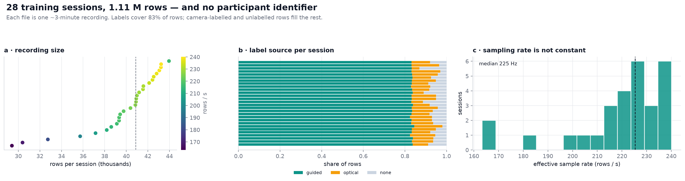

---

## 2. Schema

### 2.1 Training columns

| Group | Columns | Type | Notes |
|---|---|---|---|
| Time | `t` | float | seconds, **quantised to 1 ms and heavily repeated** |
| Arrival flags | `emg_new`, `imu_new`, `optical_new` | int | `emg_new` is always 1; the others mark sensor updates, not signals |
| EMG | `ch1` … `ch8` | float | raw ADC counts, large session-specific DC offset |
| IMU | `ax`, `ay`, `az`, `gx`, `gy`, `gz` | float | accelerometer in *g*, gyroscope in °/s; accelerometer includes gravity |
| Orientation | `roll`, `pitch`, `yaw` | float | metadata, **absent from test** |
| Target | `label` | string | `rest`, `fist`, `open`, `point`, `pinch`, `thumb-up` |
| Annotation provenance | `label_source` | string | `guided`, `optical`, `none` |
| Camera | `optical_class`, `optical_conf`, `optical_present`, `optical_score` | mixed | camera prediction; **absent from test** |
| Metadata | `handedness` | string | 97% `Right`, with brief flickers |
| Hand tracking | `thumb_curl`, `index_curl`, `middle_curl`, `ring_curl`, `pinky_curl`, `pinch`, `openness`, `thumb_up` | float | label-like / training-only |

### 2.2 Test columns

`action_id`, `t`, `emg_new`, `imu_new`, `ch1`–`ch8`, `ax`–`gz`. No labels, no camera,
no hand tracking, no orientation.

> **Submission header:** the actual `sample_submission.csv` uses **`action_id,gesture`**
> (348 rows), not the `ID,gesture` shown in the Overview example. Always reproduce the
> file's real header.

---

## 3. Time and sampling structure

### 3.1 Timestamps cannot define a window

`t` is stored at 1 ms resolution. **59% of consecutive rows share the same timestamp**
(up to 16 rows per millisecond at the start of a session). These are *not* duplicate
records: EMG changes on every row, while IMU is held until `imu_new == 1`.

**Consequence:** `t.diff()` has a median of 0 s, and timestamp-based windowing silently
drops most samples. **Window in row units.**

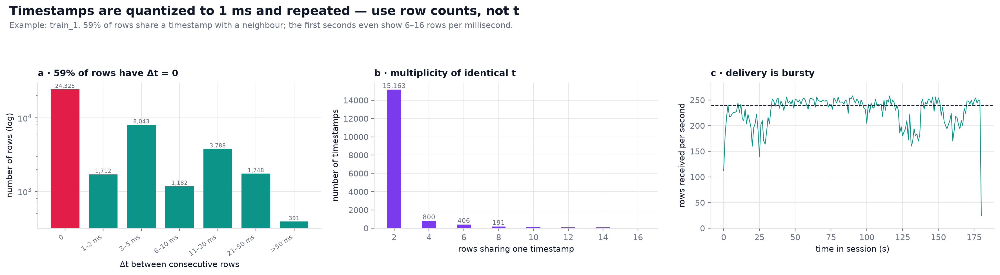

### 3.2 Effective sample rate is session-specific

| | Min | Median | Max |
|---|---:|---:|---:|
| Train sessions (rows / s) | 163.4 | 225.4 | 240.1 |
| Test actions (implied Hz) | 89.8 | 240.9 | 279.8 |

A 1.4 s window is therefore **229–336 rows in training** and **120–378 rows in test**.

**Consequences:**
1. Resample every window to a fixed length (e.g. 256 samples) or use time-normalised
   features.
2. Resize rather than zero-pad short test actions, otherwise a 120-row action looks like
   mostly silence.
3. Use Hz-based spectral features, never raw FFT bin indices.

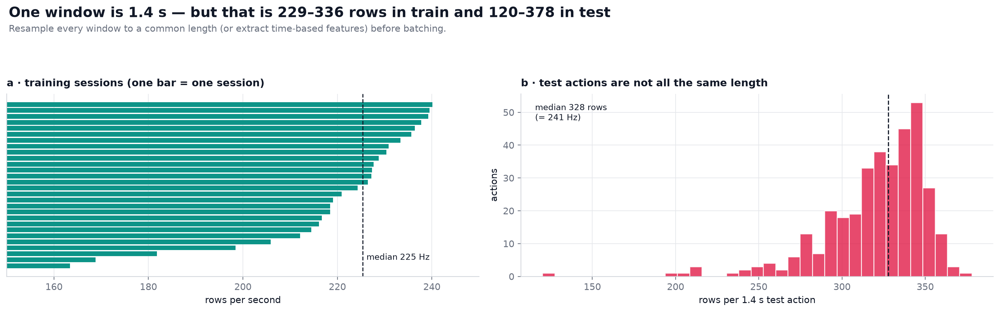

---

## 4. Labels and annotation quality

### 4.1 Only `guided` rows match the test task

| `label_source` | Share of rows | Rows | Meaning |
|---|---:|---:|---|
| `guided` | 83.3% | 925,184 | human-guided gesture blocks — usable for supervised training |
| `optical` | 9.9% | ~110k | camera-labelled, overwhelmingly `open` |
| `none` | 6.9% | ~76k | transitions, no label |

The competition guide says only `guided` rows correspond to test actions. The data
confirms this: guided rows form clean, contiguous blocks separated by short unlabelled or
camera-labelled transitions.

### 4.2 Class balance and block design

The canonical 1.4 s / 50%-stride windows yield **3,125 windows**:

| Class | Windows | Guided blocks | Median block length |
|---|---:|---:|---:|
| `rest` | 736 (23.6%) | 1,260 | 1.53 s |
| `fist` | 469 (15.0%) | 168 | 3.00 s |
| `open` | 479 (15.3%) | 168 | 3.05 s |
| `point` | 481 (15.4%) | 168 | 3.08 s |
| `pinch` | 480 (15.4%) | 170 | 3.11 s |
| `thumb-up` | 480 (15.4%) | 169 | 3.09 s |

* Gestures are held for **~3 s**, yielding about 3 windows per block.
* Rest arrives in **many short fragments**: 532 of 1,260 rest blocks are shorter than
  1.4 s and are discarded (42%). Only 6 gesture blocks are discarded.
* Strict boundary-respecting windows cover **78% of guided rows** (721,805 / 925,184).
  Overlap recovers most of the rest; the remaining loss is short rest fragments and edge
  trim.
* Macro-F1 weights every class equally, so rest over-representation must be handled with
  class-balanced loss or per-class thresholds.

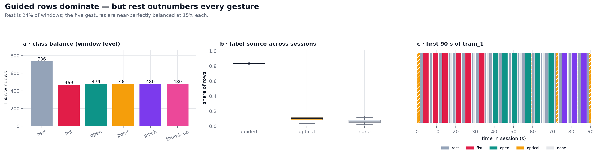
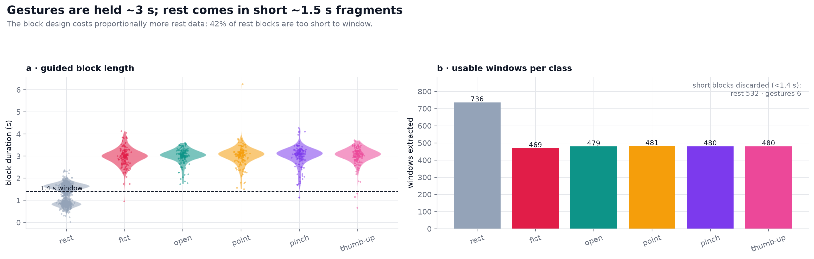

### 4.3 The camera labels are a near-constant "open" detector

On human-labelled (`guided`) rows that also have a camera prediction:

* **96.1%** of camera predictions are `open`.
* Overall row-level agreement is **20.9%**.
* Recall for `fist`, `pinch`, `point`, `thumb-up` is **0–4%**.
* Precision is 0.85 for `pinch` and 0.52 for `point` but only 0.21 for `open`.

`label_source == "optical"` therefore injects ~110k labels that are almost all `open`.
Including them as ground truth would teach the model that nearly every pose is `open`.

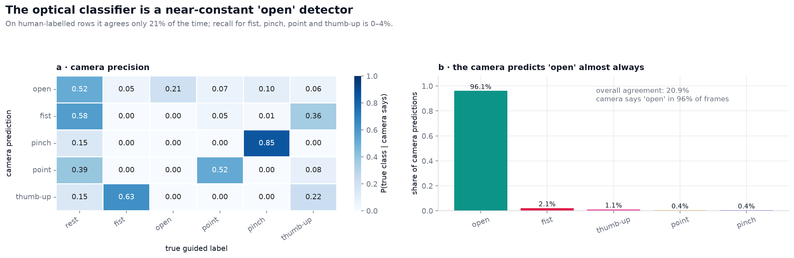

---

## 5. Signal quality

### 5.1 DC offset and gain

| Quantity | Range |
|---|---|
| Per-session median offset | −32,588 … 632,180 ADC counts |
| Per-session channel std | 112 … 207,506 counts (**1,858×**) |

The test set is **mean-centred per action** (verified: max |channel mean| = 5.0 × 10⁻⁴).
Training windows must be centred identically. Centring alone is not enough: amplitude scale
also varies by orders of magnitude, so scale normalisation is required.

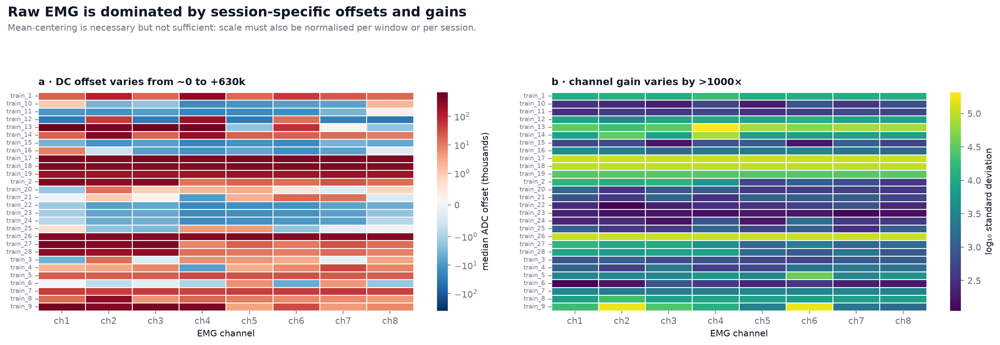

### 5.2 Saturation

| Session | Channel | Share of samples > 590k |
|---|---|---:|
| `train_13` | `ch1` | **93.0%** (median 632k, above the ~600k ADC ceiling) |
| `train_17` | `ch1` | **15.0%** |
| Other 26 sessions | any channel | 0% |

`train_13` `ch1` is unusable; a ch1-dependent model will learn a constant. Either drop the
session, mask ch1, or fit a ch1-free variant. `train_17` ch1 is only partly degraded.

### 5.3 Recording gaps

| Session | Longest gap | Location |
|---|---:|---|
| `train_16` | **22.44 s** | at the very start (`t = 0.738 → 23.178`) |
| `train_25` | 4.08 s | mid-session |
| `train_5` | 0.55 s | mid-session |
| `train_17` | 0.52 s | mid-session |

Windows must break at gaps (> 0.30 s between consecutive rows). Never interpolate across a
22 s hole: the gesture is simply missing.

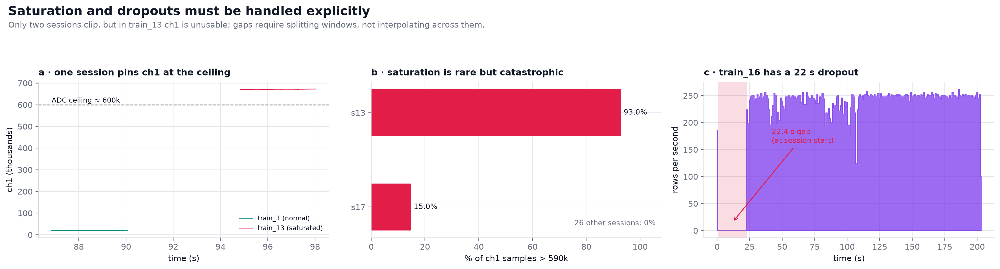

### 5.4 Spectrum

* Nyquist is only **~115 Hz** at ~230 Hz sampling, so the usual 20–450 Hz EMG band is not
  available.
* A **50 Hz ridge** appears in the session-median spectrum at **≈1.3× the local median
  power**. It is not universal: 17 of 28 sessions show a ratio above 1.1, one (`train_15`)
  is dominated by a ≈74× peak at 49.6 Hz, and some show little or none. A notch is cheap
  insurance, not a guaranteed fix.
* Window-level spectral centroid varies from **2.7 to 43.4 Hz** (median 19.7 Hz) across
  sessions. Sampling rate explains only part of this spread (Spearman ρ = 0.36,
  p = 0.060); electrode contact and filtering also contribute.

**Consequences:** notch 50 Hz (and 100 Hz if visible); normalise spectral features per
session; do not expect high-frequency EMG content.

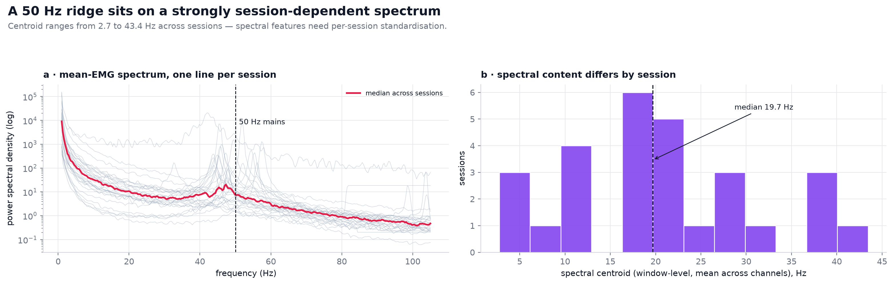

---

## 6. What separates the gestures?

### 6.1 Loudness

Session-normalised window RMS (÷ session median):

| Class | Median loudness |
|---|---:|
| `rest` | 0.90 |
| `fist` | **1.40** |
| `open` | 1.12 |
| `point` | 0.91 |
| `pinch` | 0.93 |
| `thumb-up` | 1.00 |

Fist is clearly the loudest gesture, but **point and rest are equally quiet**. Loudness
alone cannot solve the task.

### 6.2 Channels are highly redundant

* **PC1 of the 8-channel log-RMS vector explains 83.6%** of variance: all channels rise
  and fall together.
* Median channel profiles differ by only ~0.9–1.1×; there is no clean "one electrode per
  gesture" pattern.
* Within-session channels are strongly correlated (mean off-diagonal *r* ≈ 0.44; ch5–ch7
  ≈ 0.86).

**Consequence:** invest in temporal/spectral structure and cross-channel coupling rather
than per-channel amplitude ratios.

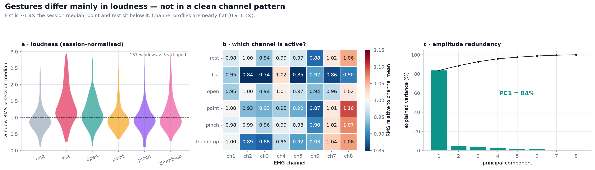

### 6.3 IMU: placement fingerprint first, motion second

* Gravity direction spans `ax` −0.99 … +0.97 g and `ay` −0.59 … +0.60 g across sessions,
  forming distinct session clusters. A model on raw accelerometer values can learn *who is
  wearing the device*.
* Per-window mean-centering removes exactly this offset (and reproduces the test
  preprocessing).
* After centring, motion is modest but informative: fist moves ~4× more than rest, and an
  IMU-only baseline reaches macro-F1 ≈ 0.25.

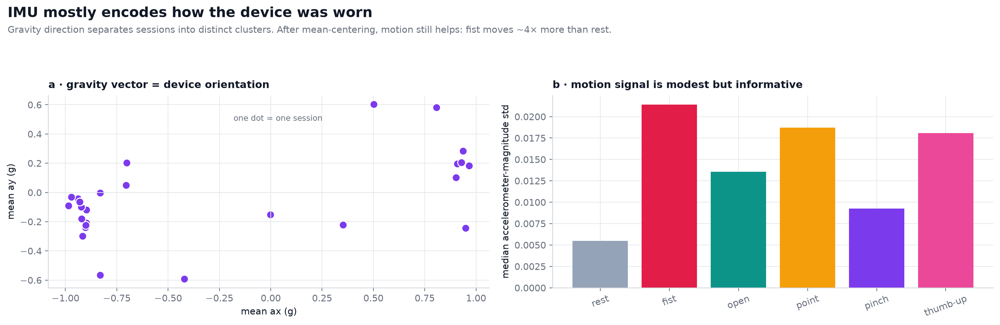

### 6.4 Statistical tests

All tests use **one summary per session (n = 28)**. Windows overlap and are not independent,
so testing at window level would pseudo-replicate the data.

| Question | Test | n | Statistic | p | Effect size | Reading |
|---|---|---:|---|---:|---|---|
| Do channel gains differ? | Friedman (repeated measures) | 28 | χ² = 22.4, df = 7 | 2.15 × 10⁻³ | Kendall's W = 0.114 | Detectable but small; channels are redundant |
| Is rest quieter than gestures? | Wilcoxon signed-rank, one-sided | 28 pairs | W = 28 | 5.52 × 10⁻⁶ | median ratio 0.91; r ≈ 0.86 | Real but modest; point is as quiet as rest |
| Is class mix consistent across sessions? | χ² on window counts | 28 × 6 | χ² = 51.1, df = 135 | 1.00 | Cramér's V = 0.057 | Protocol is balanced (design check, not inference) |

The χ² result should be read as "the recording protocol was balanced", not as evidence
about a population.

---

## 7. Train vs test comparability

The test actions are exactly mean-centred per action. Distribution comparisons are
necessarily low-powered with only 5 test files.

| Feature | Train median | Test median | Difference | Permutation p |
|---|---:|---:|---:|---:|
| Median log-RMS | 5.23 | 4.15 | −1.08 | 0.096 |
| Spectral centroid (Hz) | 19.70 | 28.55 | +8.84 | 0.108 |
| High-frequency ratio | 0.31 | 0.50 | +0.19 | 0.182 |

Neither difference survives a Bonferroni threshold of 0.05 / 3 ≈ 0.017. Treat the
higher test centroid / HF ratio as a **caution about spectral shift**, not a conclusion.

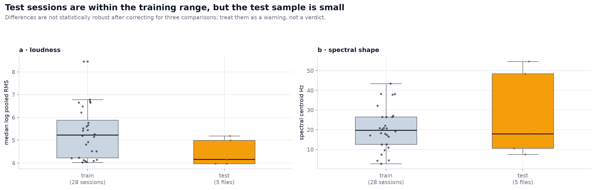

---

## 8. Leakage and validation

Every session has a strong signature. Using the same window features:

| Evaluation | Result |
|---|---|
| Gesture macro-F1, random window split | **0.47** (optimistic) |
| Gesture macro-F1, `GroupKFold` by session | **0.34** (honest) |
| Session identification accuracy (28 classes) | **89%** vs 3.6% chance |

Random splitting leaks session identity and inflates macro-F1 by **+0.13**. With unseen
participants on the leaderboard, **grouped validation by `file` is the only defensible
estimate**. Report a session-level bootstrap CI alongside the point estimate.

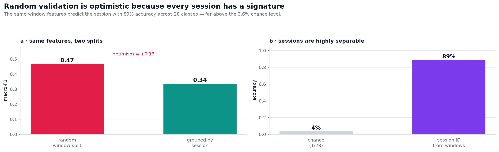

---

## 9. Preprocessing recipe

1. **Filter to `label_source == "guided"`.** Ignore `optical` and `none` for supervised
   training; optical rows may be used only as *unlabelled* data.
2. **Split each session into contiguous segments.** Break on label change, on
   non-consecutive row indices, and on time gaps > 0.30 s. Never let a window cross a
   segment boundary.
3. **Compute the session rate** (`rows / duration`) and express 1.4 s in rows. Do not
   assume 230 Hz.
4. **Extract 1.4 s windows with ~50% stride.** Discard partial windows; do not pad.
   Optionally trim 100–150 ms at both ends to avoid transition transients.
5. **Mean-centre every channel within every window**, exactly as the test set does.
6. **Normalise scale per window or per session.** For waveform models, z-score each
   channel within the window or divide by the window's channel-mean RMS. Per-file
   normalisation at test time is legal because it uses no labels.
7. **Resample each window to a fixed length** (e.g. 256 samples) for deep models. Never
   zero-pad short actions.
8. **Notch 50 Hz** (and 100 Hz if visible). Compute spectra with the session's true rate
   and use Hz-based features only.
9. **Validate with `GroupKFold` on `file`.** Report macro-F1 with a session-level
   bootstrap CI. Never use a random-window split for model selection.
10. **Handle corrupted sessions:** drop/mask `train_13` ch1 (93% saturated); treat
    `train_17` ch1 with caution (15%); break windows at the `train_16` 22 s gap.

### 9.1 Columns deliberately excluded

| Columns | Reason |
|---|---|
| `optical_class`, `optical_conf`, `optical_present`, `optical_score` | camera output; not in test; label-like |
| `roll`, `pitch`, `yaw` | orientation metadata; not in test |
| `thumb_curl` … `thumb_up` | hand-tracking / label-derived; not in test |
| `emg_new`, `imu_new`, `optical_new` | arrival flags, not sensor values |
| `handedness` | noisy metadata (97% `Right`) |
| `label_source` | annotation provenance, not a sensor input |

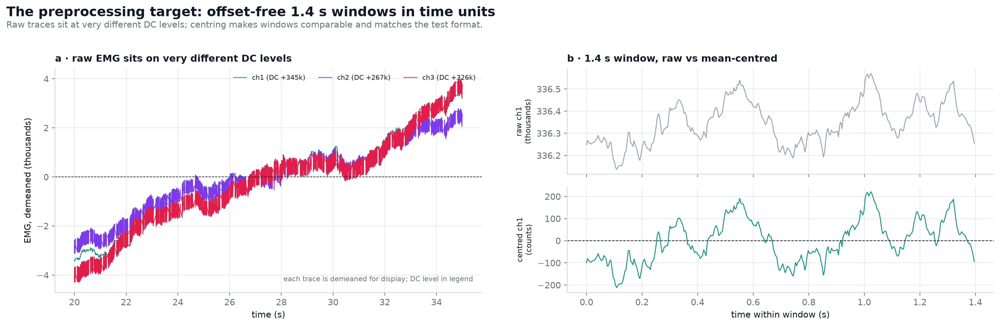

---

## 10. Baseline (sanity check, not a solution)

Multinomial logistic regression on physically motivated window features, `GroupKFold(5)`
by session:

| Feature set | Macro-F1 (grouped CV) |
|---|---:|
| EMG only | 0.290 |
| IMU only | 0.246 |
| EMG + IMU | **0.336** |
| Bootstrap 95% CI (sessions) | **[0.295, 0.382]** |

Per-class F1: rest 0.434, fist 0.406, open 0.362, point 0.356, pinch 0.223,
thumb-up 0.236. The confusion matrix is dominated by **pinch → rest (41%)** and
**thumb-up → rest (20%)**. Rest is the most common class but not the easiest.

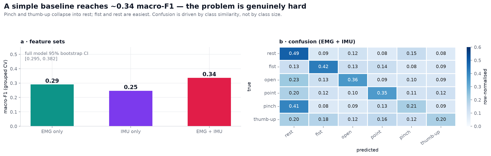

This is a **floor**, not a target. A sequence model on resampled waveforms should beat it,
but only grouped CV numbers should be trusted.

---

## 11. Modelling recommendations

1. **Primary representation:** multichannel, mean-centred, resampled 1.4 s waveforms
   (e.g. 8 × 256), fed to a 1D CNN / TCN / small transformer. EMG is the main signal; add
   IMU as auxiliary channels.
2. **Strong classical baseline:** log-RMS, zero-crossing rate, waveform length, channel
   correlations, spectral centroid, and Hz-band ratios, with gradient boosting or logistic
   regression. These are scale-robust and fast to iterate.
3. **Mandatory normalisation:** per-window mean-centring; per-window or per-session scale
   normalisation; 50 Hz notch.
4. **Class imbalance:** macro-F1 is the metric, so use class-balanced loss, per-class
   thresholds, or resampling. Do not optimise accuracy.
5. **Augmentation:** time shift/crop, amplitude scaling, channel dropout, mild noise, and
   (carefully) time warping. Avoid augmentations that change the gesture identity.
6. **Validation:** `GroupKFold` by `file`; session-level bootstrap CI; keep a held-out
   session set untouched for final model selection.
7. **Robustness checks:** train with and without the saturated `train_13` ch1; test
   models on sessions with low/high spectral centroid to gauge shift sensitivity.
8. **Do not** use camera, hand-tracking, orientation, or arrival-flag columns as features.

---

## 12. Caveats and limitations

* **No participant metadata.** We cannot verify whether two files share a participant.
  Grouping by file is conservative only if files are participants; if one person appears
  in several files, even grouped CV overestimates generalisation.
* **Test labels are unavailable.** Class balance, action difficulty, and true cross-person
  shift cannot be measured.
* **No physical units.** EMG is in ADC counts with unknown gain, so all amplitude
  conclusions are relative.
* **Low test power.** Five test files cannot support strong distributional claims; a
  non-significant result is not evidence of similarity.
* **Session-level normalisation** is estimated from all windows in a session. This is legal
  at test time but must be implemented identically.
* **Baseline only.** The 0.336 macro-F1 validates the pipeline; it is not a competitive
  score.
* **Timestamp caveat.** Because `t` is quantised, any feature based on precise timing
  (e.g. instantaneous rate, RR-like intervals) is unreliable.

---

## 13. Figure index

| Figure | File | Content |
|---|---|---|
| 1 | `01_dataset_overview.png` | session sizes, label-source mix, rate distribution |
| 2 | `02_sampling_structure.png` | Δt distribution, timestamp multiplicity, burstiness |
| 3 | `03_rate_variability.png` | train vs test window lengths |
| 4 | `04_labels_and_timeline.png` | class balance, source mix, label timeline |
| 5 | `05_block_structure.png` | guided block lengths and window yield |
| 6 | `06_camera_labels.png` | camera precision and near-constant `open` output |
| 7 | `07_dc_offsets.png` | per-session DC offsets and channel gains |
| 8 | `08_signal_quality.png` | saturation, per-session clipping, dropout timeline |
| 9 | `09_spectra.png` | PSDs, 50 Hz mains, spectral-centroid spread |
| 10 | `10_gesture_amplitude.png` | loudness, channel profiles, PCA of log-RMS |
| 11 | `11_imu.png` | gravity clusters and class-wise motion |
| 12 | `12_train_test_shift.png` | train vs test loudness and spectral shape |
| 13 | `13_leakage.png` | random vs grouped CV, session identifiability |
| 14 | `14_baseline.png` | feature-set scores and confusion matrix |
| 15 | `15_preprocessing.png` | raw DC levels and window centring |

---

## 14. Reproducibility

```
.venv/bin/jupytext --to ipynb --output notebooks/01_train_data_analysis.ipynb <notebook-source>
.venv/bin/jupyter nbconvert --to notebook --execute --inplace \
    notebooks/01_train_data_analysis.ipynb --ExecutePreprocessor.timeout=1800
```

Cached intermediates (`data/interim/*.parquet`) make re-runs fast; figures are written to
`graphs/data_analysis/`. The raw Excel files in `data/raw/` are git-ignored.

### Running on Kaggle

The notebook is self-locating and needs no path edits:

* data is found under `data/raw/{train,test}`, beside the working directory, or anywhere
  under `/kaggle/input`; `AURA_TRAIN_DIR` / `AURA_TEST_DIR` override the search;
* outputs go to `/kaggle/working` when writable (else the repository root, or
  `AURA_OUT_DIR`);
* the Parquet cache is optional, and failures to read or write it fall back to Excel;
* every figure is shown inline as well as saved, so a *Save & Run All* run produces the
  full report.

Dependencies are pinned in `requirements.txt`; on Kaggle, enable **Internet** only if you
prefer to `pip install -r requirements.txt` rather than use the preinstalled stack. The
notebook itself uses only pandas, NumPy, Matplotlib, Seaborn, SciPy, scikit-learn,
openpyxl and (optionally) pyarrow.
